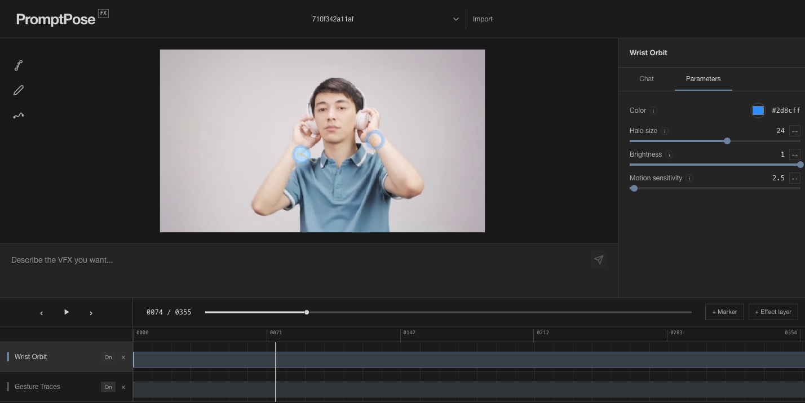

# PromptPoseFX

An AI-assisted video editor for creating pose-driven visual effects with natural language and direct canvas/timeline controls.



*Two generated Effects: wrist halos and Pose-history traces. Video and Effect data are not included in the repository.*

## What you can do

- Generate or revise effects through chat; clarify ambiguous requests with selectable options.
- Set precise references with Pose joints, Points, Paths, and Time Markers.
- Edit multiple Effect tracks, adjust parameters, and toggle layers without deleting them.
- Reuse motion, timing, or style from saved Effects by describing them, naming them, or selecting them with `@`.

## How it works

1. **Pose tracking.** The backend samples frames from the uploaded video for a 30 FPS editor timeline. MediaPipe Pose detects joint coordinates in the sampled frames, and the backend smooths them into a frame-by-frame timeline.
2. **Request handling.** MainAgent interprets the chat request alongside the editor context, including Points, Paths, and Time Markers. It asks for clarification when needed, applies simple name or parameter changes directly, and sends requests that require code to CodeAgent.
3. **Saved Effect retrieval.** An `@` selection identifies a saved Effect directly. The resolver uses repository metadata to match exact names or find the most recently updated eligible Effect when asked for the previous one. For descriptions like “the one that spreads like water ripples,” it asks the model to match names and cached behavior summaries in batches. When a query has multiple candidates, the editor asks the user to choose. The backend then checks relevant code excerpts or saved values against the chosen Effect snapshot and passes them to CodeAgent as generation context.
4. **Validation and preview.** CodeAgent produces p5.js Effect code. Static checks and a simulated render across sequential frames must pass before the Effect becomes active. The browser draws the Effect over the video using the current Pose data, timeline controls, and parameter values. The canvas and timeline share the same playback clock.

## Project scope

- **Pose-driven effects.** Effects can use tracked joint positions and motion history, plus editor Points, Paths, and Time Markers. Pixel sampling, segmentation, depth estimation, and occlusion-aware compositing are outside the current Effect runtime.
- **Local processing with a model API.** The backend stores uploaded videos and saved Effects, processes Pose data locally, and serves preview frames to the browser. AI requests send chat instructions and relevant context to the configured model endpoint. That context can include editor state, Pose statistics, saved Effect code, and parameter values. Video frames are used for local Pose processing and browser preview only.
- **Reference library.** Historical references come from active Effects saved in the local repository. The first description-based search may take longer while the backend generates summaries for existing Effects.

## Tech stack

| Area | Technology |
| --- | --- |
| Editor | React 19, Vite, Tailwind CSS 4 |
| API and agents | FastAPI, LangGraph, OpenAI-compatible model API |
| Pose processing | MediaPipe Pose, OpenCV, NumPy |
| Effect rendering | p5.js on a canvas over the video frame |
| Progress updates | HTTP API and Server-Sent Events |

## Run locally

Requirements: Python 3.10.16, Node.js 20.19+ (see `.python-version` and `.nvmrc`), and an API key for OpenAI or a compatible Chat Completions endpoint. The first video upload performs local pose processing; creating or editing an Effect with AI uses the configured model API and may incur charges.

1. Copy `.env.example` to `.env` and set `OPENAI_API_KEY`. If using a compatible gateway, also set `OPENAI_API_BASE` and model names supported by that gateway. Both MainAgent and CodeAgent require models that support tool calling. The repository ignores `.env`.
2. Start the backend from the repository root:

   ```bash
   python3.10 -m venv .venv
   source .venv/bin/activate
   python -m pip install -r vfx-agent-backend/requirements-dev.txt
   cd vfx-agent-backend
   python app.py
   ```

3. In a second terminal, start the frontend from the repository root:

   ```bash
   nvm install
   nvm use
   cd frontend
   npm ci
   npm run dev
   ```

Open `http://localhost:5200`. The frontend proxies `/api/*` to the backend on port 5800. Upload a video from the top bar and wait for pose processing to finish before creating an Effect. The frontend does not ship with a sample video or pre-generated Effects.
